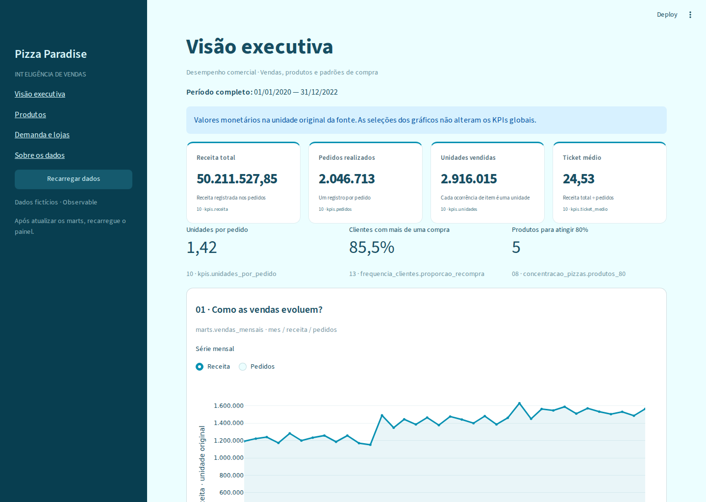

# Pizza Analytics

Pipeline autoral de Engenharia de Dados para analisar vendas de uma pizzaria,
com dados inteiramente fictícios do **Pizza Paradise / Observable**.

**Python 3.13 · uv · pandas · DuckDB · SQL · Streamlit · Plotly**

## Comece por aqui

1. [Execute do zero](guia-rapido.md): instalação, aquisição, pipeline e dashboard.
2. [Entenda os dados](modelo.md): grãos, chaves e relacionamentos.
3. [Confira os indicadores](contratos-indicadores.md): perguntas, fórmulas e aceite.
4. [Desenvolva e publique a documentação](automacao.md): CI, pre-commit e Pages.
5. [Revise a entrega](entrega.md): critérios e limitações comprovadas.

## Arquitetura

```text
Anexos oficiais CSV/Parquet
  → raw/pizza_paradise/
  → DuckDB: raw → refined → marts
  → dashboard Streamlit
```

O executor completo publica as três camadas em uma transação. Transformações
ficam no pandas; cada indicador tem seu SQL. A apresentação consulta somente
marts, sem recalcular regras de negócio.

## Resultado verificado

2.046.713 pedidos, 2.916.015 ocorrências de itens, 34.761 clientes, 32 lojas e
36 SKUs, entre 2020 e 2022. Cinco RAW, cinco refined e treze marts auditados.
Os números são resultados da versão investigada, não limites fixos da fonte.

[Veja a validação do pipeline](execucao-pipeline.md) e
[a conferência do dashboard](execucao-dashboard.md).



## Fonte e responsabilidade

Há permissão textual ampla do publicador, sem licença padronizada declarada
nos metadados dos cinco anexos. O repositório não redistribui os arquivos
completos nem o banco. [Fonte, atribuição e limites](fontes-e-licenca.md).

Os registros antigos da fonte Maven estão separados na navegação de
[histórico](historico.md), sem apagar a evolução real do projeto.
