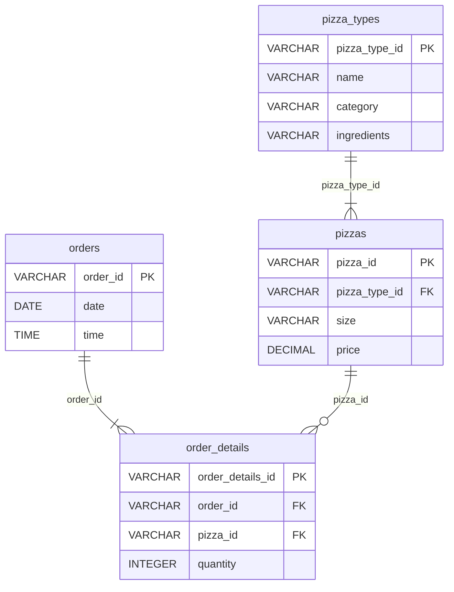

# Modelo relacional e investigação

Observações da versão 1 baixada, não metas fixas para versões futuras.
Inventário completo: [inspecao.json](evidencias/inspecao.json).

| CSV / futura tabela | Colunas observadas | Linhas | Grão e PK proposta |
|---|---|---:|---|
| orders / raw.orders | order_id, date, time | 21.350 | Um pedido registrado por uma mesa; PK order_id |
| order_details / raw.order_details | order_details_id, order_id, pizza_id, quantity | 48.620 | Uma linha de variante de pizza em um pedido; PK order_details_id |
| pizzas / raw.pizzas | pizza_id, pizza_type_id, size, price | 96 | Uma variante de tipo + tamanho; PK pizza_id |
| pizza_types / raw.pizza_types | pizza_type_id, name, category, ingredients | 32 | Um tipo de pizza do cardápio; PK pizza_type_id |

`data_dictionary.csv`: Table, Field, Description, 15 linhas; chave composta
(Table, Field), metadado auxiliar preservado localmente, fora das quatro tabelas.

Tipos do diagrama são propostas para refined. RAW terá todas as 15 colunas
como VARCHAR. Manter os nomes originais permite rastrear o dicionário.

## Evidências medidas

- Zero campos vazios em todas as colunas; isso não é resultado de ingestão SQL.
- Zero duplicatas exatas e zero chaves primárias repetidas nas quatro tabelas.
- Zero FKs órfãs nas três relações. Todos os pedidos têm itens; todos os tipos
  têm variantes. Cinco variantes não aparecem em vendas.
- Zero pares repetidos (order_id, pizza_id) e (pizza_type_id, size). O dicionário
  diz que pizzas iguais no pedido compartilham linha e aumentam quantity.
  Ainda assim, a identidade rastreável da linha é order_details_id.
- 13.149 pedidos têm mais de uma linha; máximo de 21 linhas por pedido.
- Todas as datas e horas passaram na leitura explícita `%d/%m/%Y` e `%H:%M:%S`.
  Período observado: 01/01/2015 a 31/12/2015. Fuso não informado.
- Quantidades inteiras entre 1 e 4; zero não positivas. Preços de 9,75 a 35,95
  USD, zero negativos e nenhum com mais de duas casas decimais.
- Categorias: Chicken, Classic, Supreme, Veggie. Tamanhos: S, M, L, XL, XXL.
  São domínios observados, não autorização para descartar valores novos.
- `pizza_types.csv` falhou em UTF-8 e decodificou em cp1252. Esta é uma escolha
  compatível com os bytes observados, não comprovação do encoding do exportador.
  Os demais foram lidos com utf-8-sig (aceita UTF-8 com ou sem BOM).

## Cardinalidade e risco de multiplicação

As três FKs apontam para chaves únicas verificadas. O caminho planejado para
receita é order_details → orders e order_details → pizzas → pizza_types: cada
passo N:1 deve preservar exatamente o número de linhas de itens. Nenhum JOIN de
pipeline foi implementado. Na etapa de marts, contar antes/depois de cada JOIN
e comparar IDs distintos será critério obrigatório.

Partir de orders e juntar itens aumenta a contagem para o grão de item. Não
usar COUNT(*) desse resultado como pedidos, nem AVG(price) como ticket. Primeiro
agregar a receita por order_id. Não explodir ingredients: essa lista descritiva
multiplicaria linhas e não informa quantidade nem custo de ingredientes.
